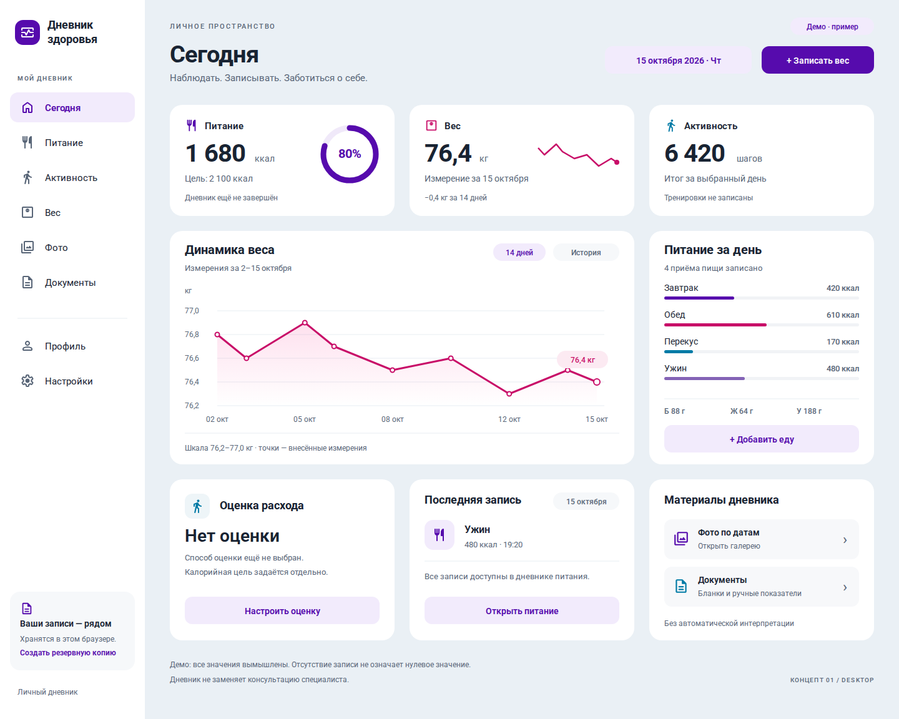
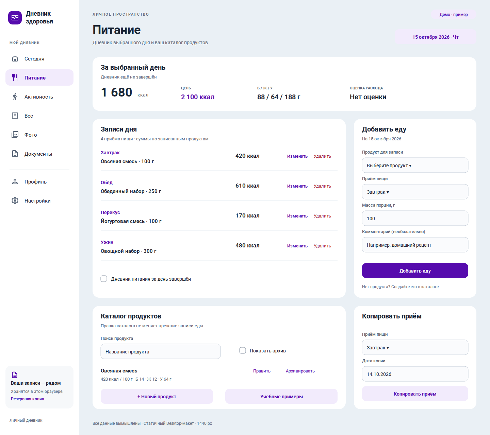
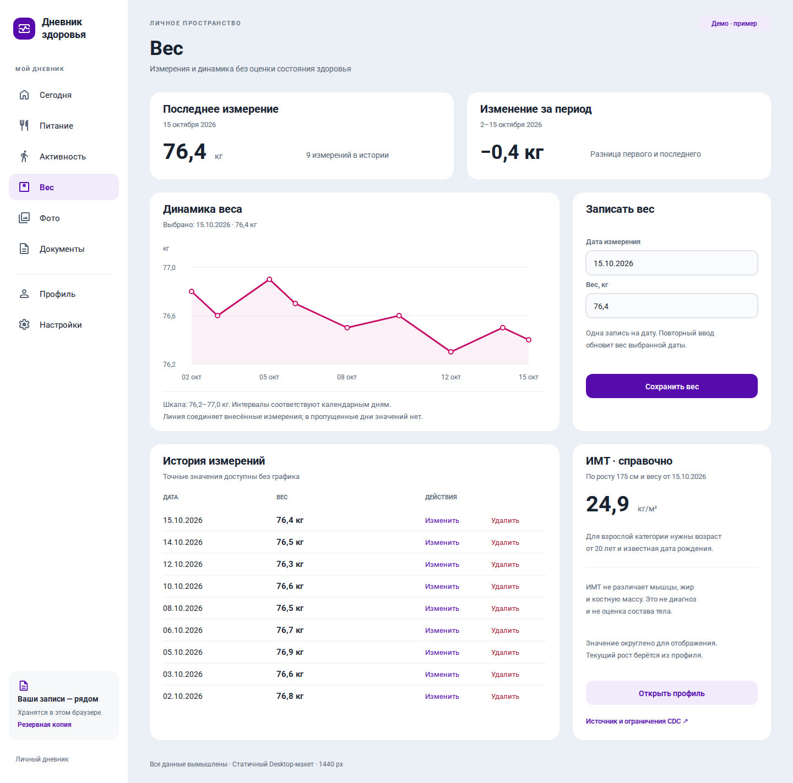
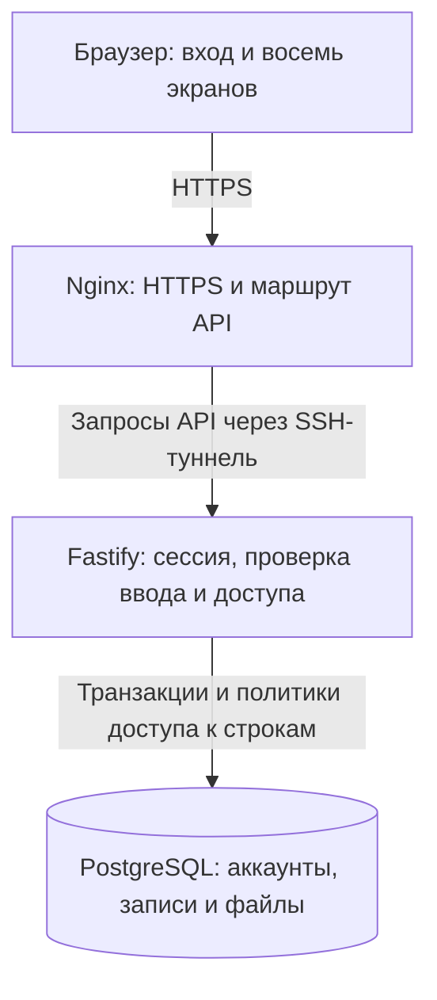
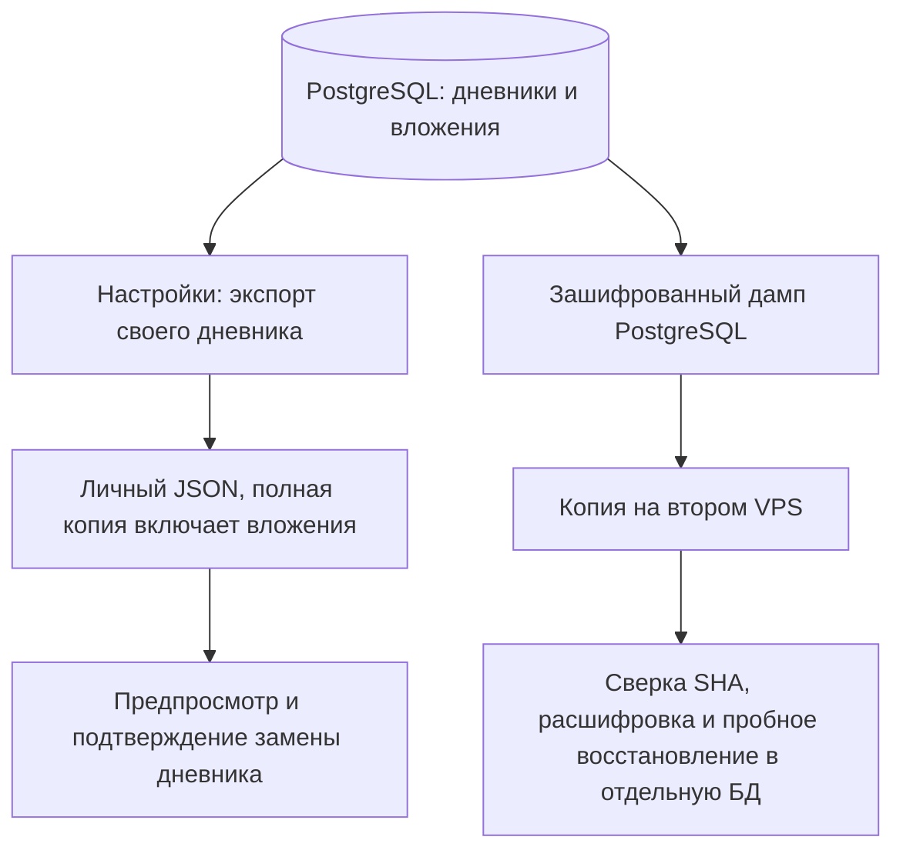
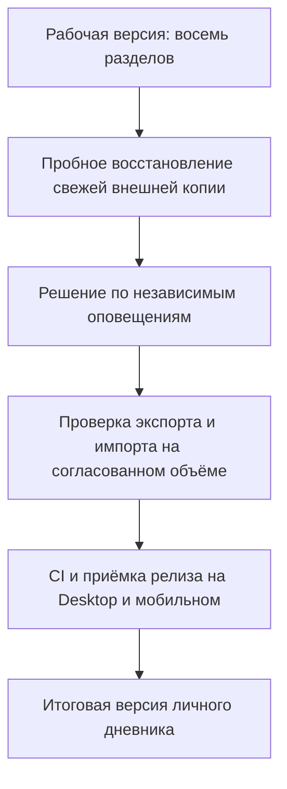

# Дневник здоровья — обзор и план итоговой версии

Основной сценарий личного дневника уже реализован. Пользователь входит, ведёт
записи за выбранный день, просматривает динамику и может сохранить копию дневника.
Одни и те же записи доступны после входа с компьютера и телефона. До итогового
выпуска предлагаю подтвердить восстановление свежей внешней копии, принять решение
по независимым оповещениям и зафиксировать поддерживаемый объём экспорта.

Обзор от 25.11.2026 основан на срезе Git `ecd3670`. Последняя приёмка,
зафиксированная в репозитории, прошла 21.10.2026 для frontend `93fa0d4`.
Её результаты описаны ниже и относятся к этой дате.

## Что уже сделали

| Раздел | Что работает |
|---|---|
| Сегодня | Сводка питания, активности и записей за выбранный день. Пропуски отличаются от нулевых значений. |
| Профиль | Первичная настройка и редактирование. Профиль и первое измерение веса сохраняются одной операцией. |
| Вес | История измерений, редактирование и график. ИМТ выводится как справочный показатель. |
| Питание | Свой каталог, порции и приёмы пищи, копирование между днями, отметка полноты дня и итоги БЖУ. |
| Активность | Шаги, тренировки и версии плана. Цель по калориям и оценка расхода показаны отдельно. |
| Фото | Загрузка, подписи и сравнение по датам. |
| Документы | Хранение оригиналов, ручной ввод показателей анализов и графики сопоставимых значений. |
| Настройки | Видимость разделов, привязка почты, экспорт файлов и записей, восстановление с предпросмотром и подтверждаемая очистка дневника. |

**Аккаунт и сохранность.** Есть регистрация с подтверждением почты, вход,
выход и восстановление доступа. Записи и вложения хранятся в PostgreSQL.
Сервер проверяет сессию, доступ владельца и версию записи перед изменением.
Есть экспорт из прежнего браузерного дневника и перенос через копию.
Контракт хранения и проверяемые критерии описаны отдельно.
[Архитектура](ARCHITECTURE.md) · [Матрица готовности](../REFACTORING_PLAN.md)

**Доставка и разработка.** GitHub Actions проверяет сборку и публикует frontend
из `dev`. API доставляется отдельно. Для разработки на новом компьютере доступны
`npm run setup` и получение настроек через ограниченный SSH-доступ. Проверка
чистого клона охватила запуск с отдельной БД, повторную настройку и вход.
[Развёртывание](DEPLOYMENT.md) · [Локальная разработка](DEVELOPMENT.md) · [T264c](tasks/T264c.md)

**Последняя зафиксированная приёмка.** CI и деплой `93fa0d4` прошли.
Шесть проверок на Desktop и Pixel 7 подтвердили вход, навигацию по восьми
экранам, вложения, создание, изменение и удаление синтетических записей.
Также проверили авторизацию API, HTTPS и точный SHA релиза.
[Приёмка T265](DEPLOYMENT.md#приёмка-t265) · [Прогон CI](https://github.com/arturican/health/actions/runs/39600567471)

## Как выглядит дневник

Ниже — три архивных макета на синтетических данных, по которым развивался
интерфейс. Текущие подписи и расположение элементов могут отличаться.

### Сегодня

Общая дата связывает записи и дневные итоги. Главная показывает, что уже
заполнено, и ведёт к подробным разделам.

### Питание

Записи сгруппированы по приёмам пищи. На одном экране можно посмотреть
состав порций и итоги дня, добавить продукт и скопировать приём пищи.

### Вес

График и история показывают измерения по датам. Записи можно добавить,
исправить или удалить.

[Галерея восьми экранов и состояний](../design/desktop/README.md)

## Куда идут записи и файлы

После входа браузер загружает дневник с сервера. Браузерная IndexedDB
сохранилась как источник явного экспорта прежнего дневника. Фотографии и
документы запрашиваются через тот же API с проверкой доступа владельца.
[Серверное хранение](SERVER_STORAGE.md) · [Контракт API](API_REFERENCE.md)

## Как можно восстановить данные

Пользовательский JSON хранится на устройстве и может содержать чувствительные
данные в открытом виде. Серверная копия шифруется отдельно и предназначена
для аварийного восстановления оператором. Лимиты экспорта из интерфейса
составляют 20 МиБ для текстового и 200 МиБ для полного JSON. Замеры показали
допустимые по остальным ограничениям сочетания, которые превышают предел
полной копии. [Резервные копии](BACKUPS.md) · [Измерения ёмкости](BACKUP_CAPACITY.md)

## Что осталось до итоговой версии

Предлагаемый итог — надёжный личный онлайн-дневник с текущими восемью разделами.
Идеи вроде PWA, распознавания анализов и совместного доступа остаются отдельными
продуктовыми решениями. [Идеи развития](../IDEAS.md)

Порядок работы, отдельные карточки и условия готовности собраны в полном плане.
[Пошаговый план итогового выпуска](RELEASE_PLAN.md)

| Порядок | Ближайшая работа | Как принять результат |
|---|---|---|
| 1 | Проверить свежую внешнюю копию и доступность ключа восстановления | Оператор сверяет контрольную сумму свежего архива, проверяет доступность защищённой копии ключа и пробное восстановление в закрытую БД. Отдельный прогон на синтетических данных подтверждает сохранность записей, вложений и прав доступа. Зафиксировать время процедуры и возможный период потери данных. [Порядок восстановления](BACKUPS.md#восстановление) |
| 2 | Решить, нужен ли независимый канал оповещений к итоговому выпуску | Если нужен, выбрать доступный канал, подтвердить получение тревоги и уведомления о восстановлении при имитации отказа и затем включить мониторинг. При переносе этого этапа зафиксировать ручной контроль и принять риск. На последней зафиксированной проверке доставка через второй VPS была отложена, а часть старых архивов оставалась без подтверждённой целостности. [Почта и статус](MAIL_MONITOR.md) · [T253a](tasks/T253a.md) · [T254c](tasks/T254c.md) |
| 3 | Утвердить объём копий, который обещает интерфейс | Согласовать ожидаемые размеры дневника и вложений, проверить экспорт и обратный импорт на синтетическом наборе с целевым объёмом. Если он превышает лимит, отдельно выбрать формат или порядок восстановления. [Измерения ёмкости](BACKUP_CAPACITY.md) |
| 4 | Принять итоговый выпуск | Пройти полный CI, сверить SHA на сайте, проверить вход, восемь экранов и сохранение записей на Desktop и мобильном. Зафиксировать результат восстановления, известные ограничения и способ отката. [Проверки](TESTING.md) · [Развёртывание](DEPLOYMENT.md) |

Первый следующий шаг — подтвердить, что свежая копия действительно
восстанавливается. Загрузка по частям и другие оптимизации имеют смысл,
если измерения на согласованном сценарии покажут проблему.
[Независимый контроль копий](BACKUP_CONTROL.md) · [Измерения загрузки](COLD_LOAD.md)
