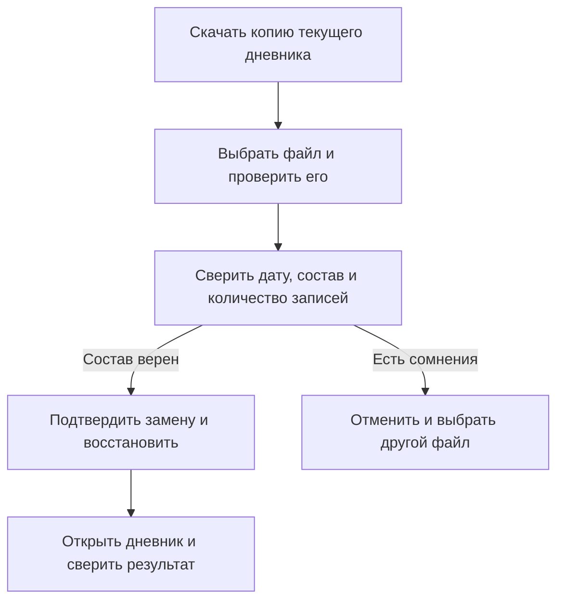

# Как пользоваться дневником здоровья

[Все документы](README.md) · [Обзор с картинками](APP_GUIDE.md)

Дневник хранит ваши записи по датам и показывает изменения со временем.
Для работы нужны подключение к интернету и аккаунт. На телефоне и компьютере
открывайте тот же сайт и входите в тот же аккаунт. Записи загружаются с сервера.

- [Вход и первый день](#вход-и-первый-день)
- [Восемь разделов](#восемь-разделов)
- [Копии, перенос и удаление](#копии-перенос-и-удаление)
- [Если что-то не получилось](#если-что-то-не-получилось)

## Вход и первый день

1. Откройте сайт дневника. Нажмите **Зарегистрироваться**, укажите почту и часовой
   пояс дневника, затем нажмите **Отправить ссылку**. Часовой пояс задаёт границу
   дня. В письме откройте ссылку подтверждения, задайте пароль длиной от 15
   символов и войдите. [Открыть дневник](https://dev.arturican.com/)
2. В разделе **Профиль** введите рост, дату и значение первого измерения веса.
   Нажмите **Создать профиль**. Имя, дата рождения и параметр пола для формулы
   расхода заполняются по желанию.
3. В разделе **Сегодня** выберите поле **День дневника** и нажмите **Открыть
   день**. Кнопка **Сегодня** возвращает текущую дату. Выбор применяется при
   переходах между разделами, использующими общий день. У форм с собственным
   полем даты проверяйте его перед сохранением.

Для входа используйте подтверждённую почту и пароль. У прежнего аккаунта поле
**Почта** принимает старый логин. Если к нему ещё не привязана почта, откройте
**Настройки → Почта и восстановление доступа**, введите адрес и текущий пароль,
затем подтвердите адрес по письму. Один адрес привязывается к одному аккаунту.

Если забыли пароль, на экране входа нажмите **Забыли пароль? → Отправить ссылку**
и используйте подтверждённую почту. После сохранения нового пароля старые
сеансы завершаются. Ссылка регистрации действует час, ссылка сброса — 15 минут.
На общем компьютере завершайте работу кнопкой **Выйти**. [Как устроен доступ](PRIVACY_SECURITY.md#хранение-и-сеть)

## Восемь разделов

### Сегодня

Сводка показывает записи и итоги за открытый день. Перейдите в нужный раздел,
чтобы дополнить данные. Если данных ещё нет, оставьте пропуск. Например, пустое
поле шагов означает отсутствие записи, а сохранённый `0` — записанное значение.

### Профиль

Кнопка **Редактировать профиль** открывает параметры для изменения. Рост нужен
для справочного ИМТ. Дата рождения и параметр пола нужны для расчёта расхода по
формуле, если вы её используете. Измерения веса хранятся отдельно по датам.

### Вес

В блоке **Записать вес** проверьте дату, введите значение в килограммах и нажмите
**Сохранить вес**. На одну дату приходится одна запись. Чтобы её исправить,
выберите **Изменить** в истории измерений. Удаление из истории требует
подтверждения. ИМТ и график служат для справки и наблюдения за динамикой.

### Питание

1. Добавьте продукт в **Каталог продуктов** с пищевой ценностью на 100 г.
   Оставьте неизвестные БЖУ пустыми. Для знакомства с формой есть кнопка
   **Добавить примеры продуктов**.
2. В блоке **Запись еды** выберите продукт и приём пищи, укажите массу порции
   в граммах и нажмите **Добавить еду**. Проверьте запись и итоги выбранного дня.
3. Прежние порции хранят значения продукта на момент записи. Правка или
   архивирование продукта сохраняют эти значения в истории. Возвращайте
   архивный продукт в каталоге, когда снова нужно его выбрать.
4. Чтобы повторить приём пищи, откройте его день, в блоке **Копировать приём
   пищи** выберите приём и дату назначения, затем нажмите **Копировать приём**.
   Отметьте день заполненным только после внесения всех приёмов пищи.

Как порции, пропуски и отметка полноты влияют на итоги и баланс, описано отдельно.
[Расчёты питания и оценочный баланс](CALCULATIONS.md)

### Активность

Введите **Шаги за день** и нажмите **Сохранить шаги**. Если запись ошибочна и
правильное значение неизвестно, используйте **Удалить итог шагов**. Для тренировки
укажите вид и длительность, по желанию добавьте ручную оценку расхода, источник
и комментарий. Тренировки можно исправлять и удалять в журнале.

В **Настройки → Цель и оценка расхода** сохраните новую версию плана с датой
начала. Калорийная цель — выбранный ориентир. Оценка расхода — отдельная величина.
Шаги и тренировки не прибавляются к общей оценке повторно.
[Как устроен план](CALCULATIONS.md)

### Фото

В блоке **Добавить фотографию** укажите дату и подпись, выберите JPEG, PNG или
WebP до 10 МиБ и нажмите **Добавить фото**. Дневник сохраняет подготовленную
JPEG-копию. Если нужен оригинал, сохраните свой исходный файл отдельно.

В **Сравнение фото** выберите две записи. В галерее доступны правка сведений
и удаление с подтверждением. Сравнение показывает снимки по датам.
[Обработка файлов и границы сравнения](PRIVACY_SECURITY.md#фото-и-документы)

### Документы

1. В блоке **Загрузить анализ** заполните сведения о бланке и нажмите
   **Добавить документ**. Поддерживаются PDF, JPEG, PNG и WebP до 20 МиБ.
   Дневник сохраняет оригинальные байты файла, включая его метаданные.
2. В списке **Открыть вложение** загружает файл. Изображение можно посмотреть,
   PDF доступен для скачивания. Для своей копии используйте **Скачать оригинал**.
3. Выберите бланк в блоке **Показатели документа**. Внесите результат вручную
   по оригиналу. График в **Динамика показателей** строится по точным числам с
   единицами. Текстовые и пороговые результаты остаются в истории.
4. Перед сравнением проверьте единицы и методику в исходных бланках. При удалении
   документа проверьте предупреждение о связанных показателях перед подтверждением.

У фото и документов общий предел вложений 100 МиБ на аккаунт. Показатели и графики
помогают найти запись и исходный бланк. Медицинскую интерпретацию обсуждайте со
специалистом. [Фото и документы](PRIVACY_SECURITY.md#фото-и-документы)

### Настройки

Здесь доступны почта, версии плана, видимость **Фото** и **Документы**, копии,
перенос прежнего дневника и удаление. При скрытии раздела записи остаются в
аккаунте и входят в полную копию. Чтобы вернуть раздел в меню, включите его и
нажмите **Сохранить видимость**.

## Копии, перенос и удаление

| Что нужно | Что выбрать в настройках |
|---|---|
| Сохранить записи веса, питания, активности, профиль и планы | **Скачать текстовую копию**. Предел JSON — 20 МиБ. Восстановление заменяет только перечисленные данные, сохраняя фото, документы, показатели и видимость. |
| Сохранить дневник с файлами и настройками | **Скачать полную копию**. В неё входят фото, оригиналы документов, показатели и скрытые разделы. Предел JSON — 200 МиБ. Большой дневник может превысить предел даже при соблюдении лимита вложений. |
| Открыть записи на новом устройстве | Войти в тот же аккаунт. Перенос через файл нужен, когда вы сознательно восстанавливаете сохранённый снимок. |
| Перенести данные прежнего браузерного дневника | Открыть тот же адрес в прежнем браузере и профиле, выбрать **Скачать прежний дневник из браузера**, затем восстановить файл как полную копию. Старое хранилище остаётся в прежнем браузере. |

В локальной проверке перенесли год синтетических записей и 100 МиБ вложений
(52 фото по 1 МиБ и 24 PDF по 2 МиБ) между двумя аккаунтами. Полный JSON занял
134,85 МиБ. Проверены настольный Chromium и эмуляция Pixel 7 на компьютере.
Фактический размер зависит от состава записей и файлов. [Отчёт о переносе](BACKUP_CAPACITY.md#полный-перенос-t278--25112026)

Оба JSON-файла содержат данные дневника в открытом виде. Храните их в защищённом
месте. Перед восстановлением скачайте свежую копию текущего дневника.

Для полной копии нажмите **Проверить полную копию**, затем прочитайте
предпросмотр. Для текстовой копии используйте **Проверить файл**. Восстановление
заменяет охваченные данные. Пустой раздел в файле тоже заменяет соответствующие
данные. При ошибке проверки или непонятном составе отмените действие.

**Удалить весь дневник** очищает профиль, записи, файлы и настройки после
явного подтверждения. Аккаунт и сеанс остаются. Скачанные файлы сохраняются
на устройстве, а прежние серверные копии сохраняются по правилам ротации.
[Подробности о копиях и удалении](PRIVACY_SECURITY.md#резервные-копии-и-удаление)

## Если что-то не получилось

| Что видно | Что сделать |
|---|---|
| Письмо не пришло, ссылка просрочилась | Проверьте адрес и «Спам». Запросите новую ссылку и используйте самое свежее письмо. |
| «Не удалось открыть дневник» | Проверьте подключение и нажмите **Повторить подключение**. Если снова появляется экран входа, войдите в свой аккаунт. |
| Видны старые данные, кнопка временно недоступна | Нажмите **Повторить загрузку**. Дождитесь свежих данных. Если запись менялась в другой вкладке, сверяйте текущую версию перед новым сохранением. |
| Запись не появилась после сохранения | Проверьте выбранный день и дату формы. Затем повторите загрузку и убедитесь, сохранилась ли запись, прежде чем добавлять её заново. |
| Фото или документы пропали из меню | Проверьте **Настройки → Видимость разделов** и аккаунт, в который вошли. |
| Файл не открывается или превышен размер | Проверьте формат и предел раздела. Сохраните исходник у себя. При недоступности вложения используйте **Повторить открытие**. |
| Текстовый экспорт превышает лимит | Попробуйте полную копию. Если и она не помещается, обратитесь к сопровождающему, чтобы выбрать способ сохранить данные. |

Сообщая о проблеме, укажите раздел, действие, время, устройство и текст ошибки.
Пароли, ссылки из писем, файлы копий, фотографии и медицинские документы
оставьте у себя. Пример для воспроизведения можно описать на вымышленных данных.
